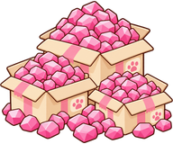

# Phong cách art được người dùng duyệt

Ngày duyệt: 2026-10-26. Người dùng xác nhận thích phong cách, đổ màu và art style của gói 16.000 gem bản hiện đại đầy ụ. Đây là hướng mặc định cho asset minh họa 2D mới của game, trừ khi người dùng yêu cầu khác. Không tự đổi toàn bộ asset cũ.

## Tham chiếu chuẩn

- Asset: `../game/assets/img/shop/gem-packs/gems_16000-modern-full.png`.
- Trong UI: `../output/gem-pack-16000-preview.png`.
- Bộ cùng phong cách: các ảnh `gems_*-modern.png` trong thư mục gem-packs.
- Prompt gốc: `../output/gem-pack-16000-abundant-generation.json` và `../output/gem-packs-modern-generation.json`.

## Đặc điểm cần giữ

- Khi restyle icon hiện có: giữ silhouette và màu nhận diện gốc, chỉ đổi cách render; chỉ thay hình tượng khi người dùng cho phép. Đợt icon navigation/liveops này chỉ Quests được đổi từ cuộn giấy sang clipboard.
- Giảm ám vàng: vùng kem dùng ivory sáng trung tính, bóng đổ nhẹ, bớt cam nâu; vẫn giữ chi tiết vàng vốn có (xe đẩy, quai lịch, nơ quà). Không phủ vàng lên toàn ảnh và không tự đổi bảng màu sang mint/hồng.

- Minh họa cartoon 2D hiện đại, dễ thương, ấm áp, hợp game nuôi mèo và trang trí nhà.
- Viền nâu ấm rõ, đều, đầu nét mềm; khối tròn, silhouette gọn và dễ đọc ở icon nhỏ.
- Màu pastel: kem, hồng phấn, peach/cam đào, mint. Gem hồng rose là điểm nhấn.
- Đổ màu phẳng, bề mặt lì, bóng cel shading nhẹ với ít cấp sáng tối; mặt gem lớn, đơn giản. Điểm sáng tiết chế.
- Vật dụng đời thường: hộp carton, túi zip, túi giấy, giỏ đựng đồ; dấu chân mèo nhỏ là chi tiết nhận diện.
- Góc nhìn ba phần tư phía trước, hình tách nền trong suốt, vật thể nằm trọn khung, rõ ở khoảng 66px.
- Gói giá trị cao cần cảm giác trù phú: nhiều vật chứa mở, gem vun cao và tràn nhẹ ra chân hộp; ưu tiên mảng khối lớn thay vì chi tiết li ti.

## Tránh

Fantasy/trung cổ, rương kho báu, viền vàng cầu kỳ, túi nhung, hiệu ứng phép thuật, lấp lánh dày đặc, gem bóng như trang sức thật, 3D photoreal, gradient bóng nhựa quá mạnh, nét đen cứng, chi tiết nhỏ rối mắt.

## Prompt nền tái sử dụng

Modern cozy cat-home mobile game item illustration; clean warm brown outlines, chunky rounded silhouette, matte pastel cream / blush pink / peach / mint palette, flat color blocks with gentle minimal cel shading, simple broad facets, everyday household packaging with subtle paw-print labels, compact three-quarter frontal composition, readable at small icon size, transparent background. No text, fantasy ornaments, gold trim, treasure chests, magic, excessive sparkles or photorealism. Use the approved gem-pack illustration as the visual style reference.

Khi tạo asset mới, truyền ảnh chuẩn làm style reference nếu công cụ hỗ trợ và kiểm tra ảnh ở kích thước dùng thật.
